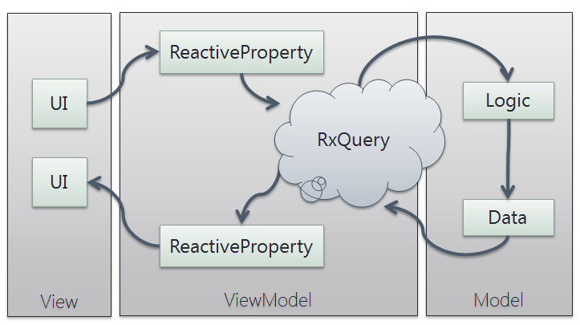
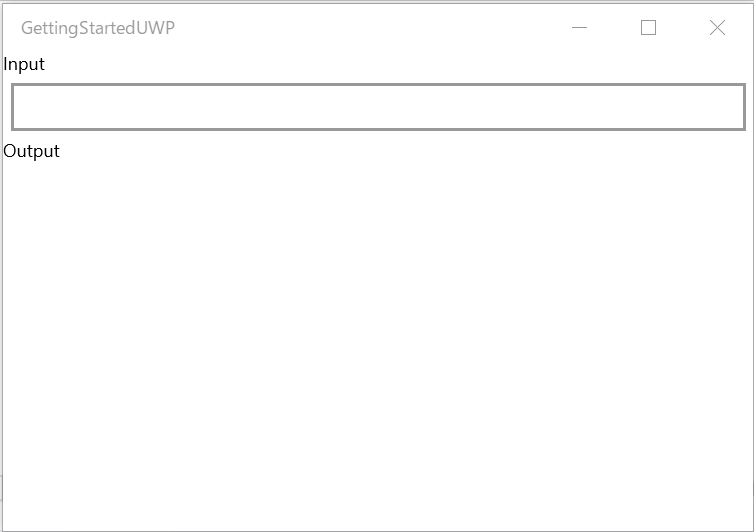

# ReactiveProperty とは

ReactiveProperty は Reactive Extensions 向けに MVVM と非同期処理を支援する機能を提供します。コア パッケージは .NET 10、.NET 11、.NET Framework 4.7.2 以降、.NET Standard 2.0 をターゲットにしています。プラットフォーム別の対象は[パッケージ一覧](#nuget-パッケージ)を参照してください。



ReactiveProperty のコンセプトは <b>楽しいプログラミング</b> です。
ReactiveProperty を使うと MVVM アプリケーションを記述できます。とても楽しいですよ！



次のコードは、ReactiveProperty と通常のオブジェクト プロパティの間の双方向バインディングを示しています。

```csharp
class Model : INotifyPropertyChanged
{
    public event PropertyChangedEventHandler PropertyChanged;

    private string _name;
    public string Name
    {
        get => _name;
        set
        {
            _name = value;
            PropertyChanged?.Invoke(this, new PropertyChangedEventArgs(nameof(Name)));
        }
    }
}
class ViewModel
{
    private readonly Model _model = new Model();
    public ReactiveProperty<string> Name { get; }
    public ViewModel()
    {
        // ReactiveProperty と Model#Name プロパティの双方向同期。
        Name = _model.ToReactivePropertyAsSynchronized(x => x.Name);
    }
}
```

ReactiveProperty は `IObservable<T>` を通じて実装されています。そうです！LINQ を使えます。

```csharp
var name = new ReactiveProperty<string>();
name.Where(x => x.StartsWith("_")) // フィルター
    .Select(x => x.ToUpper()) // 変換
    .Subscribe(x => { ... 何らかの処理 ... });
```

ReactiveProperty は `IObservable<T>` から作成されます。

```csharp
class ViewModel
{
    public ReactiveProperty<string> Input { get; }
    public ReactiveProperty<string> Output { get; }

    public ViewModel()
    {
        Input = new ReactiveProperty("");
        Output = Input
            .Delay(TimeSpan.FromSeconds(1)) // Rx メソッドを使用。
            .Select(x => x.ToUpper()) // LINQ メソッドを使用。
            .ToReactiveProperty(); // ReactiveProperty に変換
    }
}
```

このメソッド チェーンはとてもクールです。

`ICommand` と `IObservable<T>` インターフェイスを実装する `ReactiveCommand` クラスも提供しています。`ReactiveCommand` は `IObservable<bool>` から作成できます。
次のサンプルでは、`Input` プロパティが空でないときに実行できる `ReactiveCommand` を作成します。

```csharp
class ViewModel
{
    public ReactiveProperty<string> Input { get; }
    public ReactiveProperty<string> Output { get; }

    public ReactiveCommand ResetCommand { get; }

    public ViewModel()
    {
        Input = new ReactiveProperty("");
        // 上のサンプルと同じ
        Output = Input
            .Delay(TimeSpan.FromSeconds(1)) // Rx メソッドを使用。
            .Select(x => x.ToUpper()) // LINQ メソッドを使用。
            .ToReactiveProperty(); // ReactiveProperty に変換

        ResetCommand = Input.Select(x => !string.IsNullOrWhiteSpace(x)) // ReactiveProperty<string> を IObservable<bool> に変換
            .ToReactiveCommand() // IObservable<bool> から ReactiveCommand を作成できます。true 値が発行されると、コマンドを実行できます。
            .WithSubscribe(() => Input.Value = ""); // ResetCommand.Subscribe(() => ...) のショートカットです。
    }
}
```

クールです！本当に宣言的で分かりやすいです。

## ドキュメント目次

### はじめに

- [Windows Presentation Foundation](getting-started/wpf.md)
- [Universal Windows Platform](getting-started/uwp.md)
- [Xamarin.Forms](getting-started/xf.md)
- [Avalonia](getting-started/avalonia.md)
- [Uno Platform](getting-started/uno-platform.md)
- [Blazor](getting-started/blazor.md)
- [コード スニペットの追加](getting-started/add-snippets.md)

### 機能

- [ReactiveProperty](features/ReactiveProperty.md)
- [ReactivePropertySlim](features/ReactivePropertySlim.md)
- [コマンド](features/Commanding.md)
- [コレクション](features/Collections.md)
- [プレーンなモデル層のオブジェクトと連携する](features/Work-together-with-plane-model-layer-objects.md)
- [IObservable を実装した便利なクラス](features/Notifiers.md)
- [拡張メソッド](features/Extension-methods.md)
- [View から ViewModel へのイベント転送](features/Event-transfer-to-ViewModel-from-View.md)

### 応用トピック

- [スレッド制御](advanced/thread.md)
- [await 演算子と連携する](advanced/awaitable.md)
- [R3 への移行](advanced/r3-migration.md)
- [他の MVVM フレームワークと連携する](advanced/work-with-other-mvvm-framwork.md)

### サンプル

- [サンプル](samples.md)

## クイックスタート

ReactiveProperty は次のリンクから使い始めることができます。

- [Windows Presentation Foundation](getting-started/wpf.md)
- [Universal Windows Platform](getting-started/uwp.md)
- [Xamarin.Forms](getting-started/xf.md)
- [Uno Platform](getting-started/uno-platform.md)

コア機能については、次のリンクで学べます。

- [ReactiveProperty](features/ReactiveProperty.md)
- [コマンド](features/Commanding.md)
- [コレクション](features/Collections.md)


## NuGet パッケージ

|パッケージ ID|バージョンとダウンロード数|説明|
|----|----|----|
|[ReactiveProperty](https://www.nuget.org/packages/ReactiveProperty/)||System.Reactive を使った MVVM と非同期処理の機能。 `netstandard2.0;net10.0;net11.0;net472`.|
|[ReactiveProperty.Core](https://www.nuget.org/packages/ReactiveProperty.Core/)||`ReactivePropertySlim<T>` や `ReadOnlyReactivePropertySlim<T>` などの最小限の型。System.Reactive には依存しません。 `netstandard2.0;net10.0;net11.0;net472`.|
|[ReactiveProperty.WPF](https://www.nuget.org/packages/ReactiveProperty.WPF/)||WPF 向けの EventToReactiveProperty と EventToReactiveCommand ビヘイビア。 `net10.0-windows;net11.0-windows;net472`.|
|[ReactiveProperty.Blazor](https://www.nuget.org/packages/ReactiveProperty.Blazor/)||InteractiveServer レンダー モードで ReactiveProperty の検証と EditForm を連携する機能。 `net10.0;net11.0`.|
|[ReactiveProperty.R3](https://www.nuget.org/packages/ReactiveProperty.R3/)||既存の ReactiveProperty ViewModel を R3 へ移行するためのブリッジ。 `netstandard2.0;net10.0;net11.0`.|
|[ReactiveProperty.R3.WPF](https://www.nuget.org/packages/ReactiveProperty.R3.WPF/)||R3 向けの WPF EventToReactiveProperty と EventToReactiveCommand トリガー アクション。 `net10.0-windows;net11.0-windows`.|
|ReactiveProperty.UWP||UWP 向けの EventToReactiveProperty と EventToReactiveCommand が含まれます。|
|ReactiveProperty.XamarinAndroid||Xamarin.Android ネイティブのイベントから IObservable インスタンスを作成するための多くの拡張メソッドが含まれます。|
|ReactiveProperty.XamariniOS||ReactiveProperty と ReactiveCommand を Xamarin.iOS ネイティブ コントロールにバインドするための多くの拡張メソッドが含まれます。|
