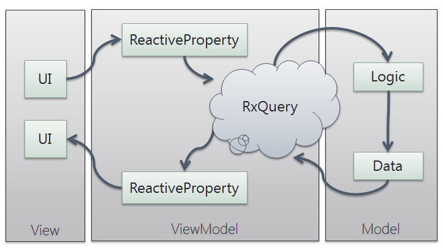

# What is ReactiveProperty

ReactiveProperty provides MVVM and asynchronous support features for Reactive Extensions. The core packages target .NET 10, .NET 11, .NET Framework 4.7.2 or later, and .NET Standard 2.0. See the [package overview](#nuget-packages) for platform-specific targets.



The concept of ReactiveProperty is <b>Fun programming</b>.
You can write MVVM applications with ReactiveProperty. It's a lot of fun!

The following code shows two-way binding between a ReactiveProperty and a plain object property.

```csharp
class Model : INotifyPropertyChanged
{
    public event PropertyChangedEventHandler PropertyChanged;

    private string _name;
    public string Name
    {
        get => _name;
        set
        {
            _name = value;
            PropertyChanged?.Invoke(this, new PropertyChangedEventArgs(nameof(Name)));
        }
    }
}
class ViewModel
{
    private readonly Model _model = new Model();
    public ReactiveProperty<string> Name { get; }
    public ViewModel()
    {
        // Two-way synchronization between ReactiveProperty and the Model#Name property.
        Name = _model.ToReactivePropertyAsSynchronized(x => x.Name);
    }
}
```

ReactiveProperty is implemented through `IObservable<T>`. Yes! You can use LINQ.

```csharp
var name = new ReactiveProperty<string>();
name.Where(x => x.StartsWith("_")) // filter
    .Select(x => x.ToUpper()) // convert
    .Subscribe(x => { ... some action ... });
```

ReactiveProperty is created from `IObservable<T>`.

```csharp
class ViewModel
{
    public ReactiveProperty<string> Input { get; }
    public ReactiveProperty<string> Output { get; }

    public ViewModel()
    {
        Input = new ReactiveProperty("");
        Output = Input
            .Delay(TimeSpan.FromSeconds(1)) // Using an Rx method.
            .Select(x => x.ToUpper()) // Using a LINQ method.
            .ToReactiveProperty(); // Convert to ReactiveProperty
    }
}
```

This method chain is very cool.

We also provide the `ReactiveCommand` class, which implements the `ICommand` and `IObservable<T>` interfaces. `ReactiveCommand` can be created from an `IObservable<bool>`.
The following sample creates a `ReactiveCommand` that can execute when the `Input` property is not empty.

```csharp
class ViewModel
{
    public ReactiveProperty<string> Input { get; }
    public ReactiveProperty<string> Output { get; }

    public ReactiveCommand ResetCommand { get; }

    public ViewModel()
    {
        Input = new ReactiveProperty("");
        // Same as the sample above
        Output = Input
            .Delay(TimeSpan.FromSeconds(1)) // Using an Rx method.
            .Select(x => x.ToUpper()) // Using a LINQ method.
            .ToReactiveProperty(); // Convert to ReactiveProperty

        ResetCommand = Input.Select(x => !string.IsNullOrWhiteSpace(x)) // Convert ReactiveProperty<string> to IObservable<bool>
            .ToReactiveCommand() // You can create ReactiveCommand from IObservable<bool>. When a true value is published, the command can execute.
            .WithSubscribe(() => Input.Value = ""); // This is a shortcut for ResetCommand.Subscribe(() => ...)
    }
}
```

Cool! It is really declarative and clear.

## Documentation contents

### Getting started

- [Windows Presentation Foundation](getting-started/wpf.md)
- [Avalonia](getting-started/avalonia.md)
- [Blazor](getting-started/blazor.md)
- [Add code snippets](getting-started/add-snippets.md)

### Features

- [ReactiveProperty](features/ReactiveProperty.md)
- [ReactivePropertySlim](features/ReactivePropertySlim.md)
- [Commanding](features/Commanding.md)
- [Collections](features/Collections.md)
- [Work together with plain model layer objects](features/Work-together-with-plane-model-layer-objects.md)
- [Useful classes which implement IObservable](features/Notifiers.md)
- [Extension methods](features/Extension-methods.md)
- [Transfer event to ViewModel from View](features/Event-transfer-to-ViewModel-from-View.md)

### Advanced topics

- [Thread control](advanced/thread.md)
- [Work with await operator](advanced/awaitable.md)
- [Migrate to R3](advanced/r3-migration.md)
- [Work with other MVVM Frameworks](advanced/work-with-other-mvvm-framwork.md)

### Samples

- [Samples](samples.md)

## Getting started

You can start using ReactiveProperty from the following links.

- [Windows Presentation Foundation](getting-started/wpf.md)

Learn the core features from the following links.

- [ReactiveProperty](features/ReactiveProperty.md)
- [Commanding](features/Commanding.md)
- [Collections](features/Collections.md)


## NuGet packages

|Package Id|Version and downloads|Description|
|----|----|----|
|[ReactiveProperty](https://www.nuget.org/packages/ReactiveProperty/)||MVVM and asynchronous features built on System.Reactive. `netstandard2.0;net10.0;net11.0;net472`.|
|[ReactiveProperty.Core](https://www.nuget.org/packages/ReactiveProperty.Core/)||Minimal types such as `ReactivePropertySlim<T>` and `ReadOnlyReactivePropertySlim<T>`, without a System.Reactive dependency. `netstandard2.0;net10.0;net11.0;net472`.|
|[ReactiveProperty.WPF](https://www.nuget.org/packages/ReactiveProperty.WPF/)||WPF EventToReactiveProperty and EventToReactiveCommand behaviors. `net10.0-windows;net11.0-windows;net472`.|
|[ReactiveProperty.Blazor](https://www.nuget.org/packages/ReactiveProperty.Blazor/)||EditForm validation integration with ReactiveProperty for InteractiveServer render mode. `net10.0;net11.0`.|
|[ReactiveProperty.R3](https://www.nuget.org/packages/ReactiveProperty.R3/)||An R3-native migration bridge for existing ReactiveProperty ViewModels. `netstandard2.0;net10.0;net11.0`.|
|[ReactiveProperty.R3.WPF](https://www.nuget.org/packages/ReactiveProperty.R3.WPF/)||R3-native EventToReactiveProperty and EventToReactiveCommand trigger actions for WPF. `net10.0-windows;net11.0-windows`.|
