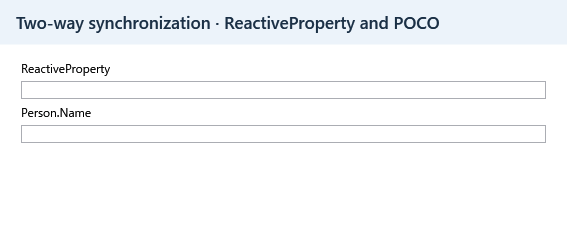
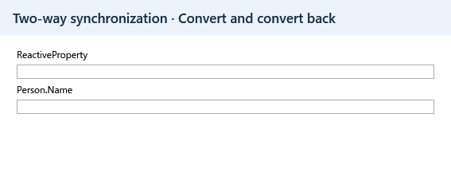
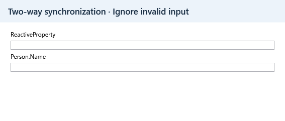

# Work with POCOs

The classes in this library can work with POCO classes.

## Connect to classes that implement `INotifyPropertyChanged`

ReactiveProperty provides many features that synchronize with a POCO class instance.

### One-way synchronization

The `ObserveProperty` extension method of the `INotifyPropertyChanged` interface converts `INotifyPropertyChanged` to `IObservable<T>`.
`IObservable` can be converted to `ReactiveProperty`. This means that you can have one-way synchronization from `INotifyPropertyChanged` to `ReactiveProperty`.

For example:

```csharp
public class BindableBase : INotifyPropertyChanged
{
    public event PropertyChangedEventHandler PropertyChanged;

    protected void RaisePropertyChanged([CallerMemberName]string propertyName = null) =>
        PropertyChanged?.Invoke(this, new PropertyChangedEventArgs(propertyName));

    protected void SetProperty<T>(ref T field, T value, [CallerMemberName]string propertyName = null)
    {
        if (Comparer<T>.Default.Compare(field, value) == 0)
        {
            return;
        }

        field = value;
        RaisePropertyChanged(propertyName);
    }
}

public class Person : BindableBase
{
    private string _name;
    public string Name
    {
        get { return _name; }
        set { SetProperty(ref _name, value); }
    }

    private int _age;
    public int Age
    {
        get { return _age; }
        set { SetProperty(ref _age, value); }
    }
}
```

One-way synchronization is written as follows.

```csharp
// using Reactive.Bindings.Extensions;
public class ViewModel
{
    private Person Person { get; } = new Person();

    public ReadOnlyReactiveProperty<string> Name { get; }

    public ReactiveCommand UpdatePersonCommand { get; }

    public ViewModel()
    {
        Name = Person
            // Convert the Name PropertyChanged event to IObservable<string>
            .ObserveProperty(x => x.Name)
            // Convert to ReadOnlyReactiveProperty<string>
            .ToReadOnlyReactiveProperty();

        UpdatePersonCommand = new ReactiveCommand()
            .WithSubscribe(() =>
            {
                // Update the name property.
                Person.Name = "Tanaka";
            });
    }
}
```

### Two-way synchronization

`ToReactivePropertyAsSynchronized` extension method provides two-way synchronization.

```csharp
// using Reactive.Bindings.Extensions;
public class ViewModel
{
    public Person Person { get; } = new Person();

    public ReactiveProperty<string> Name { get; }

    public ViewModel()
    {
        Name = Person.ToReactivePropertyAsSynchronized(x => x.Name);
    }
}
```

The following example uses WPF.

MainPage.xaml.cs

```csharp
public sealed partial class MainPage : Page
{
    private ViewModel ViewModel { get; } = new ViewModel();
    public MainPage()
    {
        this.InitializeComponent();
        DataContext = ViewModel;
    }
}
```

MainPage.xaml

```xml
<Page x:Class="App1.MainPage"
      xmlns="http://schemas.microsoft.com/winfx/2006/xaml/presentation"
      xmlns:x="http://schemas.microsoft.com/winfx/2006/xaml"
      xmlns:local="clr-namespace:App1"
      xmlns:d="http://schemas.microsoft.com/expression/blend/2008"
      xmlns:mc="http://schemas.openxmlformats.org/markup-compatibility/2006"
      mc:Ignorable="d">
    <StackPanel>
        <TextBlock Text="ReactiveProperty"
                   Margin="5,0" />
        <TextBox Text="{Binding Name.Value, Mode=TwoWay, UpdateSourceTrigger=PropertyChanged}"
                 Margin="5" />
        <TextBlock Text="Person.Name"
                   Margin="5,0" />
        <TextBox Text="{Binding Person.Name, Mode=TwoWay, UpdateSourceTrigger=PropertyChanged}"
                 Margin="5" />
    </StackPanel>
</Page>
```



The `ToReactivePropertyAsSynchronized` extension method can add conversion and convert-back logic.

```csharp
public class ViewModel
{
    public Person Person { get; } = new Person();

    public ReactiveProperty<string> Name { get; }

    public ViewModel()
    {
        Name = Person.ToReactivePropertyAsSynchronized(x => x.Name,
            convert: x => string.IsNullOrWhiteSpace(x) ? "" : $"{x}-san",
            convertBack: x => Regex.Replace(x, "-san$", ""));
    }
}
```



When the `ignoreValidationErrorValue` argument is set to true, it stops synchronization if a validation error occurs.

```csharp
public class ViewModel
{
    public Person Person { get; } = new Person();

    [StringLength(10)]
    public ReactiveProperty<string> Name { get; }

    public ViewModel()
    {
        Name = Person.ToReactivePropertyAsSynchronized(x => x.Name,
            convert: x => string.IsNullOrWhiteSpace(x) ? "" : $"{x}-san",
            convertBack: x => Regex.Replace(x, "-san$", ""),
            ignoreValidationErrorValue: true)  // activate this behavior
            .SetValidateAttribute(() => Name); // set validation logic
    }
}
```



You can also use LINQ to convert values, as shown below:

```csharp
public class ViewModel
{
    public Person Person { get; } = new Person();

    public ReactiveProperty<string> Name { get; }

    public ViewModel()
    {
        Name = Person.ToReactivePropertyAsSynchronized(x => x.Name,
            // ox is IObservable<string>. string is a type of the Name property.
            convert: ox => Observable.Merge(
                ox.Where(x => string.IsNullOrEmpty(x)).Select(_ => ""),
                ox.Where(x => !string.IsNullOrEmpty(x)).Select(x => $"{x}-san")
            ),
            // ox is IObservable<string>. string is a result type of convert logic.
            convertBack: ox => ox
                .Where(x => x.Length <= 10) // You can use all LINQ methods like this.
                .Select(x => x.Replace("-san", "")));
    }
}
```

If you want to use `ReactivePropertySlim`, you can use the `ToReactivePropertySlimAsSynchronized` extension method.
It is similar to `ToReactivePropertyAsSynchronized`. The `ignoreValidationErrorValue` and `scheduler` arguments are not available; otherwise, they are the same.

### One-way synchronization to source

The `FromObject` method creates a `ReactiveProperty` instance from a POCO.
This method sets the `Value` property from the POCO when the `ReactiveProperty` instance is created. When the `Value` property is updated, it updates the source value.

```csharp
using Reactive.Bindings;
using System;

namespace ReactivePropertyEduApp
{
    class Sample
    {
        public string Property1 { get; set; }
    }
    class Program
    {
        static void Main(string[] args)
        {
            var sample = new Sample { Property1 = "xxx" };

            var rp = ReactiveProperty.FromObject(sample, x => x.Property1);
            Console.WriteLine(rp.Value); // -> xxx
            sample.Property1 = "updated";
            Console.WriteLine(rp.Value); // -> xxx
        }
    }
}
```

### Nested property path

`ObserveProperty`, `ToReactivePropertyAsSynchronized`, `ToReactivePropertySlimAsSynchronized`, and `FromObject` support nested property paths like `x => x.Child.Name`.
If the value of any property in the path is null, ReactiveProperty sets `default(T)` to the Value property when synchronizing from the source property to ReactiveProperty, and ReactiveProperty stops synchronization to the source property when synchronizing from ReactiveProperty to the source property.

After the value is updated to a non-null value, ReactiveProperty restarts synchronization.
